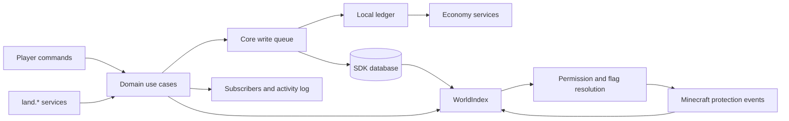

# Architecture and performance

[中文](architecture.md) · [Documentation](README.md)

This page describes the current implementation. See [data and recovery](data-and-recovery.en.md) for persistence and [the API reference](api.en.md) for extension contracts.

## Layers

| Path relative to the module root | Responsibility |
| --- | --- |
| `sapi/src/index.ts`, `sapi/manifest.json` | Lifecycle, command registration, dependencies and services |
| `sapi/src/domain/` | Models, chunk/AABB geometry, permissions, flags, errors and IDs |
| `sapi/src/cache/world-index.ts` | In-memory land, claim, area, role and relationship indexes |
| `sapi/src/store/` | SDK table definitions, repository, codecs and hydration |
| `sapi/src/services/` | Territory, membership, finance, market, quota, extension and admin use cases |
| `sapi/src/economy/` | Economy adapter, local ledger and recovery handlers registered by kind |
| `sapi/src/commands/router.ts`, `sapi/src/api.ts` | Command and inter-module service entry points |
| `sapi/src/protection/guard.ts` | Minecraft event adapters for permission/flag decisions |
| `sapi/src/runtime/` | Presence scans, border particles, expiry and recovery scheduling |
| `sapi/src/messages/` | Chinese/English messages, player locale and overrides |

## Startup and cleanup

1. SFMC registers `land.use` and `land.admin`, then protection and identity listeners.
2. Initialization reads configuration, binds the shared index and registers quota-group permissions.
3. It defines 13 `land2_` tables, hydrates the index and marks it ready.
4. It restores extensions, subscribers and player locales.
5. It provides 22 public services and starts presence, border and settlement loops.

Protection rejects player actions while the index is not ready. Startup damage and explosion guards have a wider scope; see [compatibility](compatibility.en.md). Configuration is read during initialization, without a change listener. Cleanup removes listeners, loops and services and clears the index.

The loader requires both `economy` and `activity-log`. A zero-priced operation may skip money movement, but it does not remove these module dependencies.

## Reads

A `dimensionId|chunkX|chunkZ` lookup identifies the land. Candidates indexed for that chunk are checked against their 3D AABBs. If no ordinary area matches, the land's default area is used. Protection callbacks read memory rather than querying the database on each action.

`decide` reads current relationships and roles. Flags resolve from area to land to registered default. See [permissions](permissions.en.md) for priorities and differences between adapters.

The database is the durable authority; the index is its runtime projection. Writes update the index after persistence; startup and certain post-commit failures rebuild it. A missing default area has a fallback, but a claim whose land does not exist cannot resolve and appears as wilderness. The index does not repair every kind of damaged data.

## Writes and concurrency

Territory/area mutations, membership/role changes, market operations, financial settlement and transaction recovery share a process-local write queue. Entities, authorization, coverage and quotas are reread inside the queue. Upkeep writes financial fields only, avoiding replacement of ownership from a stale snapshot.

The queue coordinates one module instance; it is not a distributed lock. Flag changes, registry changes, travel and some admin helpers should not be assumed to share every transaction boundary. SQLite transactions provide local multi-table atomicity where required.

A before callback can run while the queue is held. Return promptly and do not await another Land write that requires the same queue. An after callback failure is logged and cannot undo the committed operation.

## Economy and recovery

SQLite and the economy service do not share a transaction. Paid operations create a local ledger entry, move money using a stable idempotency key, then invoke a handler registered for the transaction kind. Recovery uses persisted payloads rather than closures from the original process.

Purchases and rentals commit entitlements, listing state and the applied ledger marker in one SQLite transaction. Lost commit acknowledgements are checked against durable state. An index failure after commit triggers hydration rather than a refund. Once an upgrade level is durable, a reward failure leaves work for recovery; external reward services must deduplicate their own side effects.

Create recovery preserves the current graph of an existing land and rejects conflicting ownership for a new create. Release recovery matches the original claim record ID and land ID, preserving later claims at the same coordinates. Lease termination changes status and revokes the tenant override in one retryable transaction.

See [data and recovery](data-and-recovery.en.md) for ledger states, scheduling and operation-specific limits.

## Performance boundaries

| Path | Current cost |
| --- | --- |
| Land lookup by chunk | Average O(1) Map lookup |
| Ordinary area lookup | O(k) candidates in the current chunk; a missing-default fallback can scan areas |
| Member/area-role lookup | Map lookup; a role permission array is checked in O(p) |
| Flag lookup | Area/land Map lookups followed by registered default |
| Area indexing and coverage validation | O(F), where F is the X/Z chunk footprint |
| Overlap validation | Filters areas for the land; the helper scans the global area collection |
| Admin lists and some ledger searches | Collection/database-result scans, without a paginated-query performance guarantee |

The index contains version and `permMemo` structures, but `decide` does not currently use that memo. This path does not memoize permission results, and management operations are not uniformly O(1). Updated decisions read the current index. Large areas are indexed across their whole X/Z footprint regardless of height; measure memory and latency on a test server.

Defaults are 20 ticks for presence scans, 40 for border display and 6000 for settlement/recovery. Tick duration depends on server performance. Presence events are sampled observations rather than exact movement traces. No built-in benchmark or player-capacity claim is provided.

## Extension boundary

Other modules call `land.*` through the service bus and register permissions, flags, conditions, rewards and subscribers. Roles store permission-ID sets. Registering a custom permission or flag does not install a Minecraft event handler; its consumer must apply it to the relevant action.

Use documented services and declare service permissions rather than depend on deep internal imports. Custom quota registration currently records an extension but does not add enforcement to core create/claim operations. See [the API reference](api.en.md).
