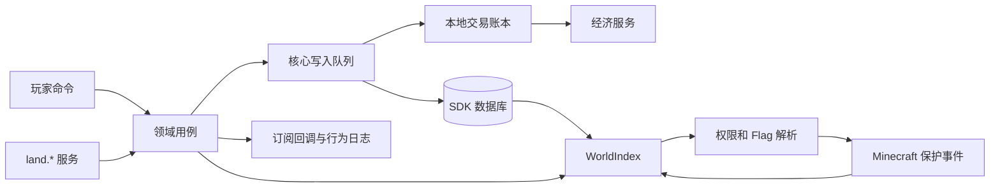

# 架构与性能

[English](architecture.en.md) · [文档目录](README.md)

本页描述当前实现。数据结构与恢复操作见[数据与恢复](data-and-recovery.md)，扩展契约见 [API](api.md)。

## 分层

| 路径（相对模块根目录） | 职责 |
| --- | --- |
| `sapi/src/index.ts`、`sapi/manifest.json` | 生命周期、命令注册、依赖与服务声明 |
| `sapi/src/domain/` | 模型、区块与 AABB 几何、权限/Flag 定义、错误、ID |
| `sapi/src/cache/world-index.ts` | 领地、区块、区域、角色和关系的内存索引 |
| `sapi/src/store/` | SDK 表定义、Repository、行编解码、启动加载 |
| `sapi/src/services/` | 领地、成员、角色、财务、市场、配额、扩展和管理用例 |
| `sapi/src/economy/` | 经济适配、本地交易账本与按种类注册的恢复处理器 |
| `sapi/src/commands/router.ts`、`sapi/src/api.ts` | 命令入口与模块间服务入口 |
| `sapi/src/protection/guard.ts` | Minecraft 事件到权限/Flag 判定的适配 |
| `sapi/src/runtime/` | 范围扫描、边界粒子、到期与恢复调度 |
| `sapi/src/messages/` | 中英文消息、玩家语言与自定义文案 |

## 启动与清理

1. SFMC 注册 `land.use`、`land.admin`，安装保护和玩家身份事件。
2. 初始化读取配置、绑定共享索引，注册配置中的配额组权限。
3. 定义 13 张 `land2_` 表；从数据库加载索引并设置就绪状态。
4. 恢复扩展注册、事件订阅、玩家语言设置。
5. 提供 22 个公开服务，启动在线扫描、边界显示和周期结算。

索引未就绪时保护入口拒绝玩家操作；伤害和爆炸的启动保护范围更宽，见[兼容性](compatibility.md)。配置只在初始化读取，没有配置热更新监听。清理时取消订阅、循环与服务，并清空索引。

加载器声明了 `economy`、`activity-log` 两个必需模块。零价格操作虽可跳过动账，仍须满足模块依赖。不能仅凭将价格设为零来卸载经济模块。

## 读取路径

位置查询先由 `dimensionId|chunkX|chunkZ` 定位领地，再在该区块的区域候选列表中检测三维 AABB；没有命中普通区域时使用该领地的默认区域。保护回调读取内存，不逐次查询数据库。

权限由 `decide` 计算，角色与关系读取当前索引；Flag 从区域、领地、注册默认值依次解析。详细优先级和保护入口的差异见[权限](permissions.md)。

数据库是持久化依据，索引是运行时投影。正常写入在落库后更新索引；启动或特定提交后异常会重新加载。缺失默认区域有兜底处理，但孤立区块引用不存在的领地时无法定位领地，会表现为荒野。索引不是损坏数据的完整修复器。

## 写入与并发

领地/区域、成员/角色、市场、财务结算及交易恢复共用进程内写入队列。在队列中重新读取对象、权限、区域覆盖与配额，避免等待事件或经济接口时继续使用过期业务状态。维护费只写财务相关字段，不整行覆盖旧领地快照。

这个队列是单个模块实例内的协调机制，不是跨进程分布式锁。Flag、注册项、传送及部分管理辅助操作也不应一概视为具有相同事务边界。SQLite 事务负责需要一起成功的本地多表变更。

执行前事件可能在持有写入队列时等待外部服务。订阅者应尽快返回，不能等待另一次需要同一队列的 Land 写操作，否则会相互等待。执行后通知失败只记日志，不撤销业务。

## 经济与恢复

SQLite 与经济服务没有跨库事务。收费路径先写本地账本，再带稳定幂等键动账，最后由交易种类对应的处理器落地。处理器使用持久化载荷，恢复不会调用重启前的闭包。

购买与租赁将权益、挂牌状态和账本成功状态放在同一 SQLite 事务内。提交确认丢失时检查持久化标记；已经提交后发生索引异常时重建索引，不能再退款。升级已写入等级后，奖励失败保留待恢复交易；外部奖励服务必须自行按收到的键去重。

创建恢复保留已有领地的当前关系；新创建遇到其他归属则拒绝。释放恢复同时核对原占领记录 ID 与领地 ID，不移除同位置后来产生的记录。租约到期将撤权与状态更新放入同一事务，失败可重试。

交易状态、周期时机、恢复范围和仍有边界的操作见[数据与恢复](data-and-recovery.md)。

## 性能边界

| 路径 | 当前复杂度与代价 |
| --- | --- |
| 由区块找领地 | Map 查询，平均 O(1) |
| 普通区域定位 | O(k)，k 为当前区块的区域候选数；缺失默认区域的兜底可能扫描区域集合 |
| 成员/区域角色查找 | Map 查询；角色权限数组检查 O(p)，p 为该角色权限数 |
| Flag 查询 | 区域、领地值的 Map 查询与注册默认值 |
| 建立区域索引/验证区块覆盖 | O(F)，F 为区域 X/Z 覆盖区块数 |
| 区域重叠验证 | 先筛选所属领地区域，当前辅助查询会扫描全局区域集合 |
| 管理列表、角色/成员列表、部分账本查找 | 遍历内存集合或数据库结果；没有分页查询性能保证 |

索引含版本与 `permMemo` 相关结构，但当前 `decide` 没有使用该 memo。不要据此宣称权限结果已缓存或所有管理操作均为 O(1)。更新后的判定直接读取新索引。大型区域即使高度很小，也会按整个 X/Z 足迹建立区块候选索引，应在测试服评估内存与操作延迟。

在线扫描默认为 20 tick、边界显示为 40 tick、结算与恢复为 6000 tick。tick 时间受服务器运行速度影响；扫描事件不是每个移动瞬间的精确轨迹。当前没有内置基准测试结果或玩家容量承诺。

## 扩展边界

其他模块通过服务总线使用 `land.*`，注册自定义权限、Flag、条件、奖励和事件订阅。角色保存权限 ID 集合。自定义 Flag 或权限需要消费模块接入自己的动作判定，注册本身不会新增 Minecraft 事件处理。

集成应依赖公开契约并声明所需服务权限，避免依赖内部深层源码导入。配额注册当前只是扩展登记，未接入核心创建/占领的额度检查。完整接口见 [API](api.md)。
